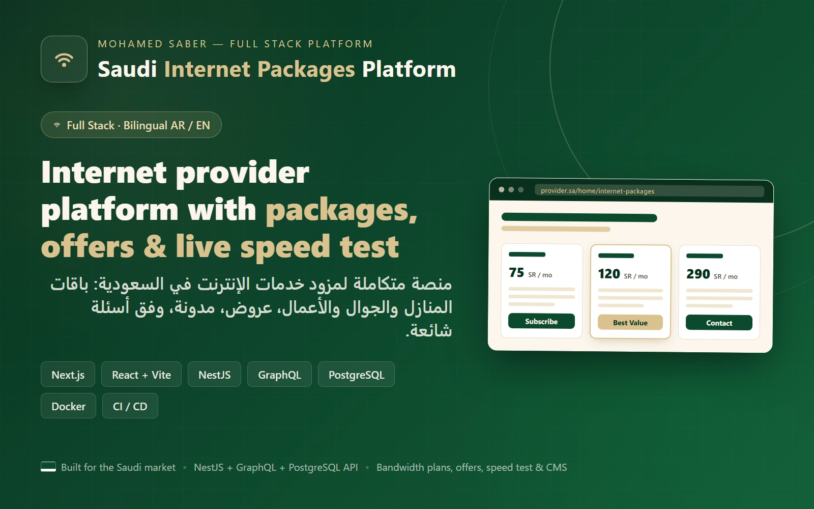
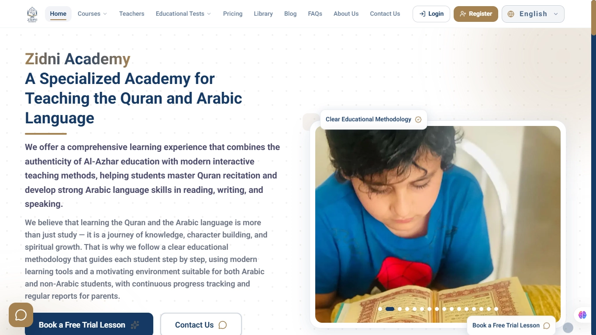
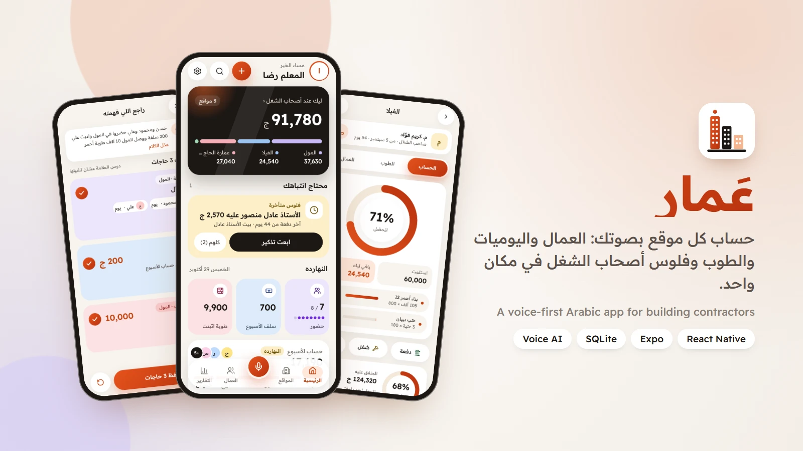

<h1>Mohamed Saber</h1>

<strong>Full-stack developer · Web, Odoo & AI</strong>

I build web applications, business integrations, and tools that simplify everyday work. 
Based in Egypt. Working with businesses across the Gulf and worldwide.

  <a href="https://www.mohamed-saber.com/en">Portfolio</a> &nbsp;·&nbsp;
  <a href="https://www.linkedin.com/in/mohamedsaber5050/">LinkedIn</a> &nbsp;·&nbsp;
  <a href="mailto:mohammed.saber.abdeltawab@gmail.com">Email</a> &nbsp;·&nbsp;
  <a href="https://www.mohamed-saber.com/en/contact"><strong>Let's work together ↗</strong></a>

 

<h2>Selected work</h2>

<table>
  <tr>
    <td width="33%" valign="top">
      
      <h3>Saudi Internet Packages</h3>
      
A bilingual service platform with a dashboard for managing content.

      
Next.js · NestJS · PostgreSQL

      <a href="https://www.mohamed-saber.com/en/projects/saudi-internet-packages-platform">Explore project ↗</a>
    </td>
    <td width="33%" valign="top">
      
      <h3>Zidni Academy</h3>
      
A learning platform connecting students with Quran and Arabic education.

      
Next.js · Node.js · MongoDB

      <a href="https://www.mohamed-saber.com/en/projects/zidni-academy-quran-and-arabic-learning-platform">Explore project ↗</a>
    </td>
    <td width="33%" valign="top">
      
      <h3>Amar</h3>
      
An Arabic contractor app with voice input and offline financial records.

      
React Native · Expo · SQLite

      <a href="https://www.mohamed-saber.com/en/projects/amar-contractor-voice-app">Explore project ↗</a>
    </td>
  </tr>
</table>

<a href="https://www.mohamed-saber.com/en/projects">View all projects →</a>

<h2>Tools I work with</h2>

TypeScript · React · Next.js · Node.js · PostgreSQL · Python · Odoo · Docker

<strong>Have something in mind?</strong> 
Web platforms, Odoo integrations, and AI automation. 
<a href="https://www.mohamed-saber.com/en/contact">Tell me about your project →</a>

