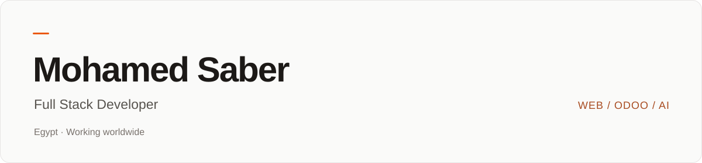

  <a href="https://www.mohamed-saber.com/en"><strong>Portfolio &amp; case studies</strong></a>
  &nbsp; · &nbsp;
  <a href="https://www.mohamed-saber.com/en/contact"><strong>Discuss a project</strong></a>
  &nbsp; · &nbsp;
  <a href="https://www.linkedin.com/in/mohamedsaber5050/">LinkedIn</a>
  &nbsp; · &nbsp;
  <a href="https://wa.me/201210529969">WhatsApp</a>

# Software built around your business.

I'm **Mohamed Saber**, a full stack developer based in Egypt. I build **web applications, business platforms, Odoo integrations and AI-powered tools**—connecting the customer experience with the systems that support it.

I work with businesses in **Egypt and the Gulf**, including Saudi Arabia, the UAE and Kuwait, and welcome remote projects worldwide. My work spans **Arabic and English interfaces**, backend APIs, administration dashboards and deployment.

## What I can help you build

| Your business need | How I can help |
| :--- | :--- |
| **A stronger digital presence** | Company websites and landing pages with bilingual content, mobile layouts and technical SEO foundations. |
| **A platform for your operations** | Booking systems, learning platforms, customer portals and dashboards with role-based access. |
| **Connected commerce** | Online stores, payment integrations, product management and connections to existing business systems. |
| **Less repetitive work** | Odoo customization, API integrations, AI assistants and workflow automation. |
| **An experience beyond the browser** | React Native applications with Arabic/English support and offline workflows where needed. |

## Selected work

Real project context, implementation details and screenshots are available in the linked case studies.

| Project | What it brings together |
| :--- | :--- |
| **[Saudi Internet Packages Platform](https://www.mohamed-saber.com/en/projects/saudi-internet-packages-platform)** | A bilingual service catalogue, content dashboard, backend API and WhatsApp enquiry flow for the Saudi market. |
| **[Unique Beauty Care](https://www.mohamed-saber.com/en/projects/unique-beauty-care-online-store)** | An online retail experience built with Next.js. |
| **[Zidni Academy](https://www.mohamed-saber.com/en/projects/zidni-academy-quran-and-arabic-learning-platform)** | A Quran and Arabic learning platform with multilingual content management. |
| **[Dr. Sally Mounir](https://www.mohamed-saber.com/en/projects/dr-sally-mounir-therapy-and-booking-platform)** | A therapy and booking platform connecting appointment scheduling, payments and administration. |
| **[Amar](https://www.mohamed-saber.com/en/projects/amar-contractor-voice-app)** | An Arabic contractor-management app combining offline records, voice input and an AI assistant. |

**[Explore the full portfolio →](https://www.mohamed-saber.com/en/projects)**

## Engineering toolkit

| Area | Technologies |
| :--- | :--- |
| **Frontend** | TypeScript · JavaScript · React · Next.js · Tailwind CSS |
| **Backend & APIs** | Node.js · Express · NestJS · REST · GraphQL |
| **Data** | PostgreSQL · MongoDB · SQLite |
| **Business systems & AI** | Odoo · Python · LLM integrations · Conversational interfaces |
| **Mobile** | React Native · Expo |
| **Delivery** | Git · GitHub · Docker · CI/CD |

## How I approach a project

1. **Understand the workflow.** Define the users, business goals, constraints and integrations before choosing the implementation.
2. **Make the scope clear.** Agree on the first release, deliverables and milestones, with designs and progress available for review.
3. **Build for everyday use.** Consider mobile usability, Arabic/RTL layouts, permissions, maintainability and search visibility where relevant.
4. **Plan the handover.** Include deployment, documentation and support arrangements in the project scope.

## Let's discuss your project

Building a website, launching a platform or connecting existing systems? Send a short brief with your **business type, target market, required features and intended timeline**.

**[Request a project quote →](https://www.mohamed-saber.com/en/contact)**

[Email](mailto:mohammed.saber.abdeltawab@gmail.com) · [WhatsApp](https://wa.me/201210529969) · [LinkedIn](https://www.linkedin.com/in/mohamedsaber5050/)

### لعملاء مصر والخليج

أساعدك في تصميم وتطوير مواقع وتطبيقات ويب بالعربية والإنجليزية، وربط الأنظمة وتطوير حلول أودو وأتمتة الأعمال. أعمل مع عملاء مصر والسعودية والإمارات والكويت، وأستقبل المشاريع عن بُعد من جميع الدول.

**[استعرض أعمالي](https://www.mohamed-saber.com/ar/projects) · [اطلب عرض سعر لمشروعك](https://www.mohamed-saber.com/ar/contact)**

---

  Based in Egypt · Arabic &amp; English · Available for freelance and contract projects

