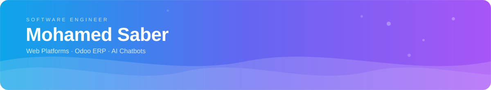

<div align="center">
  
</div>

<br/>

<p align="center">
  <a href="https://www.mohamed-saber.com/en">Website</a> &nbsp;·&nbsp;
  <a href="https://www.mohamed-saber.com/en/projects">Projects</a> &nbsp;·&nbsp;
  <a href="https://www.mohamed-saber.com/en/services">Services</a> &nbsp;·&nbsp;
  <a href="https://www.linkedin.com/in/mohamedsaber5050/">LinkedIn</a> &nbsp;·&nbsp;
  <a href="https://api.whatsapp.com/send?phone=201210529969">WhatsApp</a> &nbsp;·&nbsp;
  <a href="https://t.me/Mo7amed_Saber3">Telegram</a>
</p>

<p align="center">
  I build reliable web platforms, Odoo ERP customizations, and AI chatbot solutions<br/>
  with a focus on clear requirements, maintainable code, and practical business outcomes.
</p>

<br/>

### About

```ts
const mohamed = {
  name: "Mohamed Saber",
  role: "Software Engineer",
  location: "Egypt",
  markets: ["Egypt", "GCC"],
  education: "B.Sc. Information Technology — Beni-Suef University (Computers & AI)",

  focus: [
    "Web applications & dashboards",
    "Odoo ERP customization & integrations",
    "AI chatbots & workflow automation",
    "Bilingual (Arabic/English) and RTL-first interfaces",
  ],

  technologies: {
    frontend: ["React", "Next.js", "TypeScript", "Tailwind CSS"],
    backend: ["Node.js", "NestJS", "REST APIs", "GraphQL"],
    data: ["MongoDB", "PostgreSQL"],
    erpAndAutomation: ["Odoo", "Python", "Integrations", "AI chatbots"],
  },

  experience: [
    { company: "EngoSoft", location: "Cairo", role: "Front-End Developer", period: "May 2025 – Present" },
    { company: "Nasser Pharmacy (Remza Investment Co.)", location: "Remote", role: "Front-End Developer", period: "Aug 2024 – Apr 2025" },
    { company: "AiTech", location: "6th of October", role: "Front-End Developer", period: "Jan 2024 – Jul 2024" },
  ],

  selectedWork: [
    "Saudi Internet Packages Platform",
    "Kidentials Multi-Vendor Marketplace",
    "Dr. Sally Mounir Therapy & Booking Platform",
    "Moqauel Contractor Management SaaS",
  ],

  availability: "Open to freelance projects, consulting, and long-term collaboration",
};
```

<br/>

### Contact

Open to freelance projects, consulting, and long-term collaboration.

- **Website:** [mohamed-saber.com/en/contact](https://www.mohamed-saber.com/en/contact)
- **LinkedIn:** [linkedin.com/in/mohamedsaber5050](https://www.linkedin.com/in/mohamedsaber5050/)
- **WhatsApp:** [+20 121 052 9969](https://api.whatsapp.com/send?phone=201210529969)
- **Telegram:** [@Mo7amed_Saber3](https://t.me/Mo7amed_Saber3)
- **GitHub:** [github.com/MohamedSaber55](https://github.com/MohamedSaber55)
