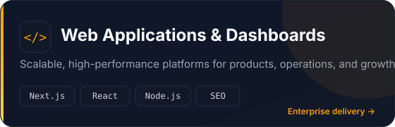
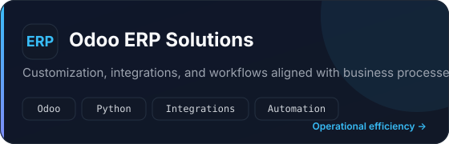
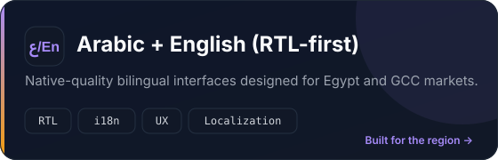
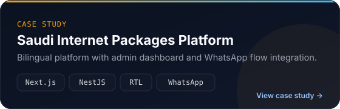
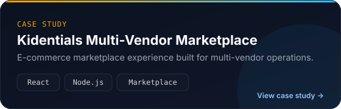
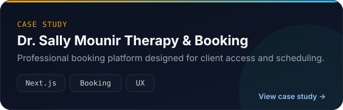

<div align="center">


<br/>

<a href="https://www.mohamed-saber.com/en/contact"></a>
&nbsp;&nbsp;
<a href="https://www.mohamed-saber.com/ar/contact"></a>

<br/><br/>

<a href="https://www.mohamed-saber.com/en"></a>
<a href="https://www.linkedin.com/in/mohamedsaber5050/"></a>
<a href="https://api.whatsapp.com/send?phone=201210529969"></a>
<a href="https://t.me/Mo7amed_Saber3"></a>

<br/>


&nbsp;


<br/>

**[English](https://www.mohamed-saber.com/en)** · **[العربية](https://www.mohamed-saber.com/ar)** · **[Case Studies](https://www.mohamed-saber.com/en/projects)** · **[Services](https://www.mohamed-saber.com/en/services)**

</div>


## Executive Summary

I am **Mohamed Saber**, a Software Engineer based in Egypt, partnering with businesses across **Egypt and the GCC** to deliver reliable, scalable digital products. I specialize in building **production-grade web applications, Odoo ERP customizations, and AI-powered chatbots** with true **Arabic + English (RTL-first)** experiences.

My approach combines clean engineering, business-focused delivery, and clear documentation — so every engagement is maintainable, measurable, and ready to grow.

```ts
const mohamed = {
  role: "Software Engineer",
  location: "Egypt (serving Egypt & GCC)",
  education: "B.Sc. Information Technology — Beni-Suef University (Computers & AI)",
  focus: ["Web Platforms", "Odoo ERP", "AI Chatbots & Automation", "Bilingual RTL Products"],
  stack: ["React", "Next.js", "TypeScript", "Node.js", "NestJS", "MongoDB", "GraphQL", "Odoo", "Python"],
  languages: ["Arabic (Native)", "English (Professional)"],
  availableFor: ["Freelance", "Consulting", "Long-term partnerships"],
};
```


## Core Capabilities

<table>
  <tr>
    <td width="50%"><a href="https://www.mohamed-saber.com/en/services/web-development"></a></td>
    <td width="50%"><a href="https://www.mohamed-saber.com/en/services/odoo-erp-solutions"></a></td>
  </tr>
  <tr>
    <td width="50%"><a href="https://www.mohamed-saber.com/en/services/chatbot-development"></a></td>
    <td width="50%"><a href="https://www.mohamed-saber.com/en/services"></a></td>
  </tr>
</table>

## Featured Case Studies

<table>
  <tr>
    <td width="50%"><a href="https://www.mohamed-saber.com/en/projects/saudi-internet-packages-platform"></a></td>
    <td width="50%"><a href="https://www.mohamed-saber.com/en/projects/kidentials-multi-vendor-marketplace"></a></td>
  </tr>
  <tr>
    <td width="50%"><a href="https://www.mohamed-saber.com/en/projects/dr-sally-mounir-therapy-and-booking-platform"></a></td>
    <td width="50%"><a href="https://www.mohamed-saber.com/en/projects/moqauel-contractor-management-saas-platform"></a></td>
  </tr>
</table>

<div align="center">
  <a href="https://www.mohamed-saber.com/en/projects"><b>Explore all projects & case studies →</b></a>
</div>


## Technology Stack



<br/>

<div align="center">

| Domain | Technologies |
|:---|:---|
| **Frontend** | React, Next.js, TypeScript, Tailwind CSS, Responsive & RTL-first UI |
| **Backend** | Node.js, NestJS, REST APIs, GraphQL, Authentication & Integrations |
| **Data** | MongoDB, PostgreSQL, Data modeling, Migrations |
| **ERP & Automation** | Odoo customization, Workflow automation, AI chatbot integrations |
| **Delivery** | Git, CI/CD awareness, Performance, SEO, Maintainable architecture |

</div>

## Professional Experience

| Organization | Role | Period | Focus |
|:---|:---|:---:|:---|
| **EngoSoft** · Cairo | Front-End Developer | May 2025 – Present | Building production applications and delivering business-facing features |
| **Nasser Pharmacy** (Remza Investment Co.) · Remote | Front-End Developer | Aug 2024 – Apr 2025 | Developing and maintaining customer-facing web experiences |
| **AiTech** · 6th of October | Front-End Developer | Jan 2024 – Jul 2024 | Front-end development and UI implementation for product features |

## Delivery Principles

- **Business-aligned:** Solutions designed around real workflows and measurable outcomes.
- **Enterprise mindset:** Emphasis on reliability, scalability, and clean, maintainable code.
- **Bilingual by design:** Native-quality Arabic/English interfaces with proper RTL support.
- **Transparent delivery:** Clear communication, documentation, and case-study-driven results.


## GitHub Insights

<div align="center">
  
  
</div>

<div align="center">
  
</div>

## Current Focus

- Delivering production applications at **EngoSoft**
- Deepening expertise in **NestJS, GraphQL, and service-oriented architecture**
- Integrating **AI capabilities** into practical business products
- Open to **freelance projects, consulting, and open-source collaboration**

<details>
<summary><b>🇪🇬 نبذة بالعربية</b></summary>
<br/>
<div dir="rtl" align="right">



أنا **محمد صابر**، مهندس برمجيات من مصر أعمل مع الشركات في مصر ودول الخليج لتقديم حلول رقمية موثوقة وقابلة للتوسع. أختص في تطوير **تطبيقات الويب، تخصيص أنظمة Odoo ERP، وروبوتات المحادثة المدعومة بالذكاء الاصطناعي** مع واجهات عربية/إنجليزية احترافية ودعم كامل لاتجاه RTL.

**ما أقدمه:** منصات ويب ولوحات تحكم، حلول ERP مخصصة، أتمتة وذكاء اصطناعي، وتجارب ثنائية اللغة مهيأة للنمو.

<a href="https://www.mohamed-saber.com/ar/contact"><b>اطلب استشارة أو عرض سعر لمشروعك ←</b></a>

</div>
</details>


<div align="center">

### Let's Build Something Exceptional

For project inquiries, consulting, or partnerships:

<a href="https://www.mohamed-saber.com/en/contact"><b>Website Contact</b></a> ·
<a href="https://www.linkedin.com/in/mohamedsaber5050/"><b>LinkedIn</b></a> ·
<a href="https://api.whatsapp.com/send?phone=201210529969"><b>WhatsApp</b></a> ·
<a href="https://t.me/Mo7amed_Saber3"><b>Telegram</b></a>

<br/>

<sub>Engineering with clarity, quality, and business impact.</sub>

</div>
